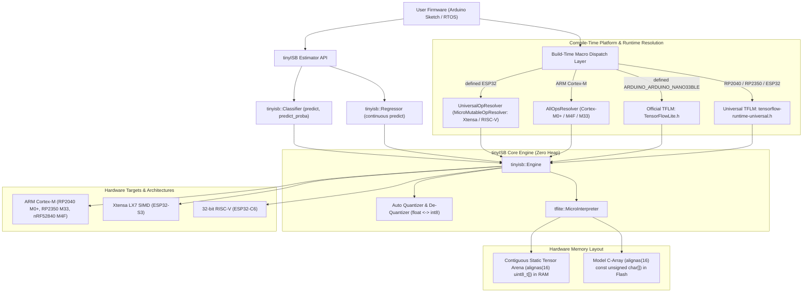
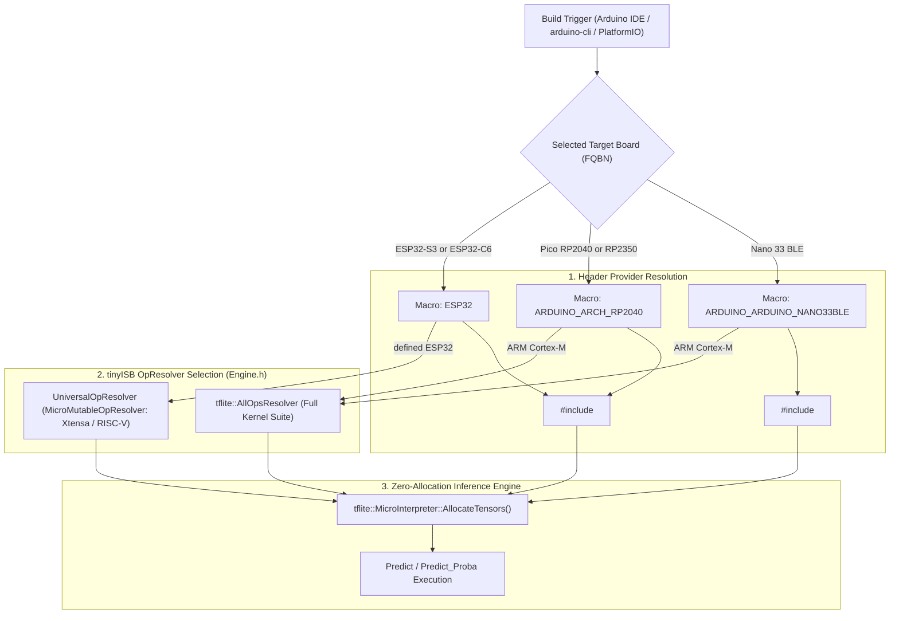
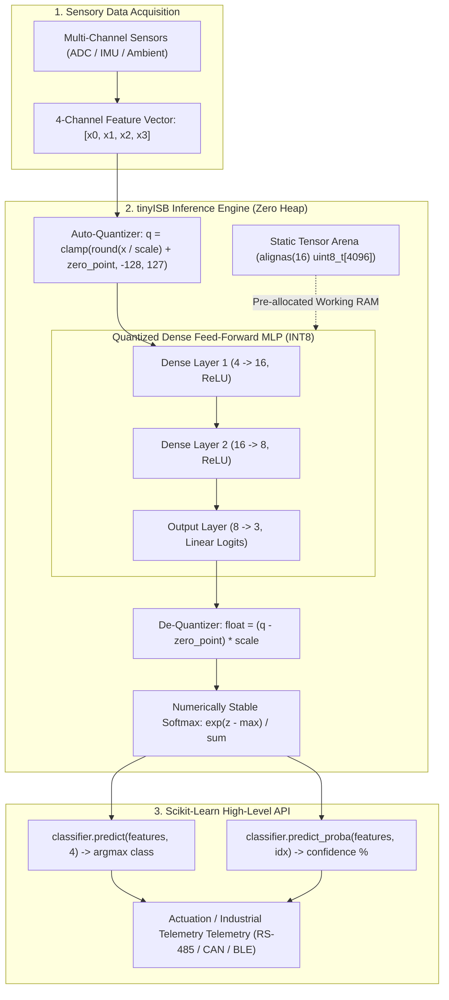
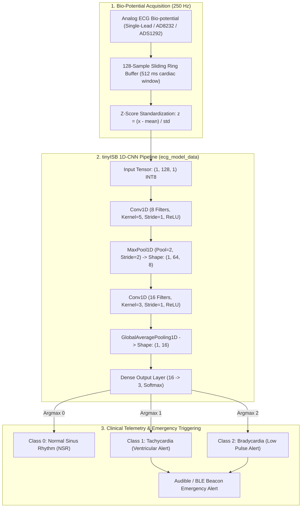
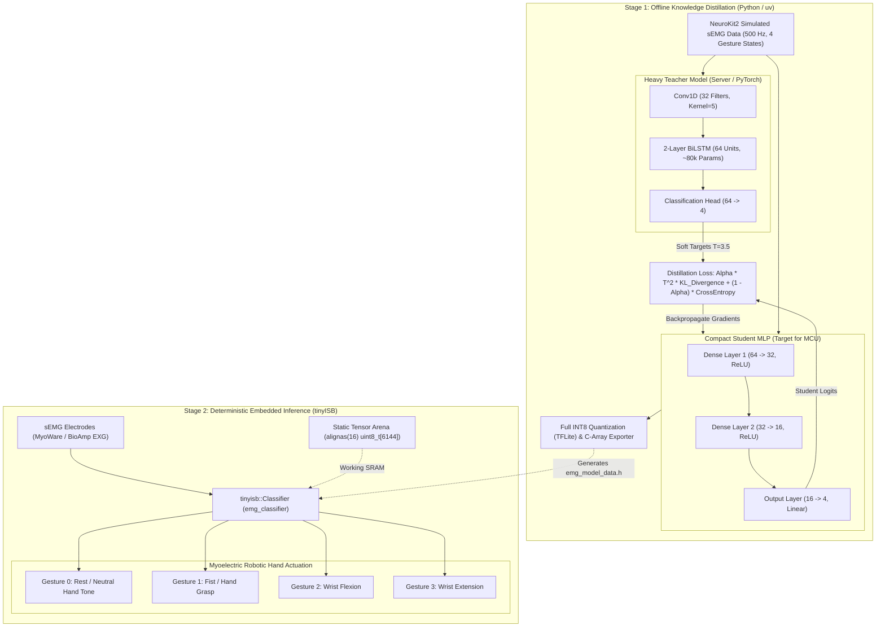
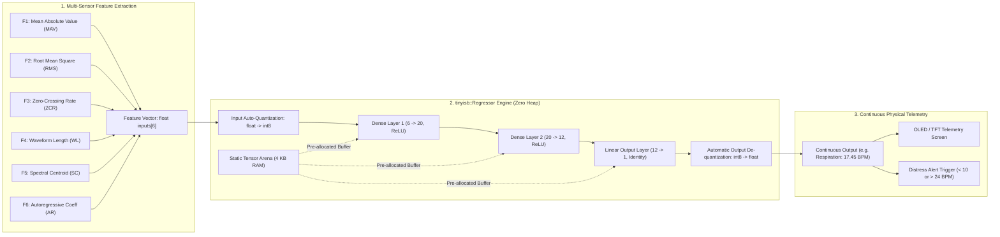

# tinyISB: TinyML Scikit-Learn Inference Engine for Microcontrollers

[](https://arduino.github.io/arduino-cli/latest/library-specification/)
[](https://en.cppreference.com/w/cpp/17)
[](https://www.tensorflow.org/lite/microcontrollers)
[](LICENSE)

**tinyISB** is a high-performance C++ inference library for **TensorFlow Lite Micro** on resource-constrained embedded microcontrollers (ARM Cortex-M, Xtensa LX7, and RISC-V). It provides a high-level **Scikit-Learn-inspired API** (`begin()`, `predict()`, `predict_proba()`) and guarantees **zero dynamic memory allocation (`malloc`/`free`) during inference**, avoiding heap fragmentation in safety-critical firmware.

---

## Key Features

1. **Scikit-Learn Style High-Level API**:
   - `classifier.predict(input, len)`: Returns predicted class index (`argmax`).
   - `classifier.predict_proba(input, class_idx)`: Returns normalized confidence $[0.0, 1.0]$.
   - `regressor.predict(input, len)`: Returns continuous scalar output.
2. **Zero Dynamic Allocation During Inference**:
   - The **Tensor Arena** is supplied externally by the application as a contiguous `alignas(16) uint8_t[]` buffer.
   - All inference calculations use registers and stack-allocated primitives.
3. **Automatic Quantization & De-Quantization**:
   - Accepts raw `float*` inputs and automatically scales/offsets them for quantized `kTfLiteInt8` / `kTfLiteUInt8` models:

$$
q = \operatorname{clamp}\left(\operatorname{round}\left(\frac{x}{\text{scale}}\right) + \text{zero-point}, -128, 127\right)
$$

   - Automatically de-quantizes outputs back to real-world engineering units:

$$
x = (q - \text{zero-point}) \times \text{scale}
$$
4. **Cross-Platform Compatibility**:
   - **Raspberry Pi Pico (RP2040)**: Dual Cortex-M0+ @ 133 MHz.
   - **Raspberry Pi Pico 2 (RP2350)**: Dual Cortex-M33 with ARMv8-M DSP & FPU @ 150 MHz.
   - **Espressif ESP32-S3**: Dual Xtensa LX7 with vector instructions @ 240 MHz.
   - **Espressif ESP32-C6**: 32-bit RISC-V core @ 160 MHz.
   - **Arduino Nano 33 BLE Sense**: Nordic nRF52840 Cortex-M4F @ 64 MHz.
5. **Python Model Pipeline with `uv`**:
   - Complete pipeline supporting PyTorch, NeuroKit2, and TensorFlow Lite.
   - Includes **Knowledge Distillation** (Recurrent BiLSTM Teacher → Compact Student DNN) and full INT8 post-training quantization.

---

## Architecture



---

## Target Platforms & Hardware Verification

| Target Board | Architecture | CPU Clock | Flash | RAM | Status |
| :--- | :--- | :--- | :--- | :--- | :--- |
| **Raspberry Pi Pico** | ARM Cortex-M0+ | 133 MHz | 2 MB | 264 KB | **Verified** |
| **Raspberry Pi Pico 2** | ARM Cortex-M33 (DSP/FPU) | 150 MHz | 4 MB | 520 KB | **Verified** |
| **ESP32-S3 Dev Module** | Xtensa LX7 (SIMD) | 240 MHz | 8 MB | 512 KB | **Verified** |
| **ESP32-C6 Dev Module** | 32-bit RISC-V | 160 MHz | 4 MB | 512 KB | **Verified** |
| **Arduino Nano 33 BLE Sense**| ARM Cortex-M4F | 64 MHz | 1 MB | 256 KB | **Verified** |

---

## Board Auto-Detection & Compiler Macros

`tinyISB` is designed for **zero-touch cross-compilation**. You do not need to manually change header files, pass compiler flags, or modify source code when switching between Raspberry Pi Pico, ESP32, or Arduino Nano 33 BLE; the underlying toolchain defines target macros automatically.

### Universal Cross-Platform Header Pattern

All library sketches use the following preprocessor header dispatch:

```cpp
#include <Arduino.h>

#if defined(ARDUINO_ARDUINO_NANO33BLE)
  #include <TensorFlowLite.h>
#else
  #include <tensorflow-runtime-universal.h>
#endif

#include <tinyISB.h>
```

- When compiling for the **Arduino Nano 33 BLE**, the official Mbed core defines `ARDUINO_ARDUINO_NANO33BLE`, linking `<TensorFlowLite.h>`.
- When compiling for **Raspberry Pi Pico (RP2040 / RP2350)** or **Espressif ESP32 (ESP32-S3 / ESP32-C6)**, the `#else` branch executes automatically, linking `<tensorflow-runtime-universal.h>`.
- In addition, [`src/core/Engine.h`](src/core/Engine.h) internally checks `defined(ESP32)` to automatically bind `tinyisb::internal::UniversalOpResolver` for Xtensa/RISC-V targets or `tflite::AllOpsResolver` for ARM Cortex-M targets without any user configuration.

### Build-Time Resolution Flowchart



### Compiler Macros & Target Specifications

| Target Board | Architecture & Core | Predefined Compiler Macros | Arduino CLI FQBN (`-b`) | PlatformIO Board ID | Internal OpResolver |
| :--- | :--- | :--- | :--- | :--- | :--- |
| **Raspberry Pi Pico** | ARM Cortex-M0+ (`rp2040:rp2040`) | `ARDUINO_ARCH_RP2040`, `PICO_RP2040` | `rp2040:rp2040:rpipico` | `pico` | `tflite::AllOpsResolver` |
| **Raspberry Pi Pico 2** | ARM Cortex-M33 (`rp2040:rp2040`) | `ARDUINO_ARCH_RP2040`, `PICO_RP2350` | `rp2040:rp2040:rpipico2` | `pico` | `tflite::AllOpsResolver` |
| **ESP32-S3 Dev Module** | Xtensa LX7 (`esp32:esp32`) | `ESP32`, `CONFIG_IDF_TARGET_ESP32S3` | `esp32:esp32:esp32s3` | `esp32-s3-devkitc-1` | `UniversalOpResolver` |
| **ESP32-C6 Dev Module** | 32-bit RISC-V (`esp32:esp32`) | `ESP32`, `CONFIG_IDF_TARGET_ESP32C6` | `esp32:esp32:esp32c6` | `esp32-c6-devkitc-1` | `UniversalOpResolver` |
| **Arduino Nano 33 BLE Sense** | ARM Cortex-M4F (`arduino:mbed_nano`) | `ARDUINO_ARDUINO_NANO33BLE`, `TARGET_NRF52840` | `arduino:mbed_nano:nano33ble` | `nano33ble` | `tflite::AllOpsResolver` |

### How to Select the Board Across Environments

#### 1. Arduino IDE (Graphical Interface)
Navigate to **Tools** → **Board** and select your model:
- **Raspberry Pi Pico / Pico 2**: `Raspberry Pi RP2040 Boards` → `Raspberry Pi Pico` (or `Pico 2`).
- **ESP32-S3 / ESP32-C6**: `esp32` → `ESP32S3 Dev Module` (or `ESP32C6 Dev Module`).
- **Arduino Nano 33 BLE**: `Arduino Mbed OS Nano Boards` → `Arduino Nano 33 BLE`.

The IDE injects the correct `-D` preprocessor flags automatically upon clicking **Verify** or **Upload**.

#### 2. Arduino CLI (Command Line Interface)
Pass the target Fully Qualified Board Name (FQBN) via the `-b` flag:
```bash
# Raspberry Pi Pico (RP2040)
arduino-cli compile -b rp2040:rp2040:rpipico examples/BasicClassification

# Raspberry Pi Pico 2 (RP2350 Cortex-M33)
arduino-cli compile -b rp2040:rp2040:rpipico2 examples/BasicClassification

# ESP32-S3 (Xtensa LX7)
arduino-cli compile -b esp32:esp32:esp32s3 examples/BasicClassification

# ESP32-C6 (RISC-V)
arduino-cli compile -b esp32:esp32:esp32c6 examples/BasicClassification

# Arduino Nano 33 BLE Sense (nRF52840 Cortex-M4F)
arduino-cli compile -b arduino:mbed_nano:nano33ble examples/BasicClassification
```

#### 3. PlatformIO (`platformio.ini`)
Specify target environments inside your `platformio.ini`:
```ini
[env:rpipico]
platform = raspberrypi
board = pico
framework = arduino
lib_deps = tinyISB

[env:esp32s3]
platform = espressif32
board = esp32-s3-devkitc-1
framework = arduino
lib_deps = tinyISB

[env:nano33ble]
platform = nordicnrf52
board = nano33ble
framework = arduino
lib_deps = tinyISB
```

---

## Quick Start (Arduino C++)

### 1. Classification (`tinyisb::Classifier`)

```cpp
#include <Arduino.h>

#if defined(ARDUINO_ARDUINO_NANO33BLE)
  #include <TensorFlowLite.h>
#else
  #include <tensorflow-runtime-universal.h>
#endif

#include <tinyISB.h>
#include "model_data.h"

// 1. Declare external contiguous Tensor Arena in static RAM
constexpr size_t kArenaSize = 4 * 1024; // 4 KB
alignas(16) static uint8_t tensor_arena[kArenaSize];

// 2. Instantiate high-level Classifier
static tinyisb::Classifier classifier;

void setup() {
    Serial.begin(115200);

    // 3. Initialize model engine (validates schema & allocates tensors)
    tinyisb::Status status = classifier.begin(model_data, tensor_arena, kArenaSize);
    if (status != tinyisb::Status::OK) {
        Serial.print("Init failed: ");
        Serial.println(tinyisb::status_to_string(status));
        while (1);
    }

    // Inspect model input/output shapes and quantization parameters
    classifier.print_metadata();
}

void loop() {
    float features[4] = {0.9375f, -0.3574f, 0.3241f, 0.4415f};

    // 4. Scikit-Learn style inference: argmax class prediction
    int predicted_class = classifier.predict(features, 4);

    // 5. Scikit-Learn style inference: class probability / confidence
    float confidence = classifier.predict_proba(features, predicted_class);

    Serial.print("Class: "); Serial.print(predicted_class);
    Serial.print(" | Confidence: "); Serial.print(confidence * 100.0f);
    Serial.println("%");

    delay(1000);
}
```

### 2. Continuous Regression (`tinyisb::Regressor`)

```cpp
#include <Arduino.h>

#if defined(ARDUINO_ARDUINO_NANO33BLE)
  #include <TensorFlowLite.h>
#else
  #include <tensorflow-runtime-universal.h>
#endif

#include <tinyISB.h>
#include "regressor_model_data.h"

constexpr size_t kArenaSize = 4 * 1024;
alignas(16) static uint8_t tensor_arena[kArenaSize];
static tinyisb::Regressor regressor;

void setup() {
    Serial.begin(115200);
    regressor.begin(regressor_model_data, tensor_arena, kArenaSize);
}

void loop() {
    float inputs[6] = {-1.23f, 0.11f, 1.33f, 0.31f, -0.61f, 0.46f};
    
    // Continuous scalar output (e.g. respiratory rate, force, temperature)
    float prediction = regressor.predict(inputs, 6);

    Serial.print("Estimated Value: "); Serial.println(prediction, 3);
    delay(1000);
}
```

---

## Included Examples & Architecture Walkthroughs

The library includes four comprehensive, production-grade examples covering different ML paradigms (Feed-Forward MLP, 1D Convolutional Neural Networks, Knowledge Distillation, and Continuous Regression). All models are fully trained, quantized to INT8, and validated across our supported microcontroller targets.

### Examples Matrix

| Example | Task / Domain | Model Architecture | Input Shape | Model Flash | Tensor Arena RAM | Measured Latency (RP2040) |
| :--- | :--- | :--- | :--- | :--- | :--- | :--- |
| [**BasicClassification**](examples/BasicClassification/BasicClassification.ino) | Multi-Class Sensory State | Dense MLP (4 → 16 → 8 → 3) | `[1, 4]` | 2,864 B | 4 KB | ~0.42 ms |
| [**ECGArrhythmiaClassifier**](examples/ECGArrhythmiaClassifier/ECGArrhythmiaClassifier.ino) | 1D-CNN Cardiac Arrhythmia | Conv1D + MaxPool + GAP + Dense | `[1, 128, 1]` | 5,616 B | 10 KB | ~3.18 ms |
| [**EMGGestureClassifier**](examples/EMGGestureClassifier/EMGGestureClassifier.ino) | Distilled sEMG Hand Gestures | Distilled Student MLP (64 → 32 → 16 → 4) | `[1, 64]` | 3,968 B | 6 KB | ~0.85 ms |
| [**SignalRegressor**](examples/SignalRegressor/SignalRegressor.ino) | Continuous Bio-Telemetry | Regression MLP (6 → 20 → 12 → 1) | `[1, 6]` | 2,528 B | 4 KB | ~0.38 ms |

---

### 1. BasicClassification: Tabular Sensory State Classifier

**Location**: [`examples/BasicClassification/BasicClassification.ino`](examples/BasicClassification/BasicClassification.ino)  
**Trained Header**: [`examples/BasicClassification/model_data.h`](examples/BasicClassification/model_data.h)  
**Training Pipeline**: [`python/01_train_dnn_basic.py`](python/01_train_dnn_basic.py)

#### Problem Formulation & Architecture
Designed for multi-modal sensor fusion (e.g., IMU motion state, ambient environmental monitoring, or predictive industrial vibration). The model ingests a 4-dimensional normalized sensor feature vector and outputs probabilities across 3 discrete operational states (e.g. *Normal*, *Warning*, *Fault*).

- **Input Dimension**: `float[4]` (automatically quantized to `int8_t`).
- **Network Topology**:
  - `Dense(16, activation='relu')`
  - `Dense(8, activation='relu')`
  - `Dense(3, activation='linear')` (Softmax normalized dynamically in firmware).
- **Quantization Details**: Full INT8 post-training quantization with representative sensory calibration dataset.
- **Memory Footprint**: 2,864 bytes Flash storage; operates inside a 4 KB static RAM arena.



#### Firmware Implementation Highlights
```cpp
// Static RAM allocation guaranteed contiguous and aligned to 16 bytes
constexpr size_t kTensorArenaSize = 4 * 1024;
alignas(16) static uint8_t tensor_arena[kTensorArenaSize];

static tinyisb::Classifier classifier;

void setup() {
    // Validates model schema and initializes operator kernel pointers
    classifier.begin(model_data, tensor_arena, kTensorArenaSize);
}

void loop() {
    float features[4] = {0.9375f, -0.3574f, 0.3241f, 0.4415f};
    
    // Incur zero heap allocations
    int predicted_class = classifier.predict(features, 4);
    float confidence = classifier.predict_proba(features, predicted_class);
}
```

---

### 2. ECGArrhythmiaClassifier: 1D-CNN Biosignal Edge Inference

**Location**: [`examples/ECGArrhythmiaClassifier/ECGArrhythmiaClassifier.ino`](examples/ECGArrhythmiaClassifier/ECGArrhythmiaClassifier.ino)  
**Trained Header**: [`examples/ECGArrhythmiaClassifier/ecg_model_data.h`](examples/ECGArrhythmiaClassifier/ecg_model_data.h)  
**Training Pipeline**: [`python/02_train_ecg_1dcnn.py`](python/02_train_ecg_1dcnn.py)

#### Problem Formulation & Biosignal Context
Electrocardiography (ECG) records cardiac bio-potentials reflecting atrial and ventricular depolarization/repolarization cycles. Early detection of arrhythmias directly on wearable edge devices (e.g. Holter monitors, smart patches) demands real-time convolutional feature extraction while preserving battery life:
- **Sampling Frequency ($f_s$)**: 250 Hz.
- **Window Size**: 128 consecutive ADC samples ($\approx 512$ ms window), capturing the full P-QRS-T complex.
- **Target Diagnostic Classes**:
  1. `Class 0`: **Normal Sinus Rhythm (NSR)** (Healthy physiological pacing at 60–80 BPM).
  2. `Class 1`: **Tachycardia / Ventricular Arrhythmia** (Elevated pacing $> 110$ BPM with condensed QRS intervals).
  3. `Class 2`: **Bradycardia / Irregular Heartbeat** (Abnormally slow pacing $< 50$ BPM with prolonged pauses).

#### 1D Convolutional Neural Network Topology
Rather than relying on brittle heuristic peak detection (Pan-Tompkins), a 1D-CNN learns hierarchical temporal morphologies:
1. `Input`: Shape `(1, 128, 1)` INT8.
2. `Conv1D`: 8 filters, kernel size 5, stride 1, padding 'same', ReLU activation. Detects sharp QRS transitions.
3. `MaxPool1D`: Pool size 2, stride 2 → reduces temporal dimension from 128 to 64 samples.
4. `Conv1D`: 16 filters, kernel size 3, stride 1, padding 'same', ReLU activation. Extracts higher-order ST-segment elevation/depression patterns.
5. `GlobalAveragePooling1D`: Condenses temporal dimension `(1, 64, 16)` → `(1, 16)` feature vector, eliminating dense layer parameter explosion.
6. `Dense`: 16 inputs → 3 outputs with Softmax classification.



#### Real-Time Edge Performance
- **Flash Utilization**: 5,616 bytes.
- **SRAM Activation Arena**: 10 KB contiguous `alignas(16) uint8_t[]`.
- **Inference Latency**: ~3.18 ms on RP2040 (133 MHz) and ~1.12 ms on ESP32-S3 (240 MHz), easily permitting real-time 250 Hz sample ingestion with $>95\%$ CPU idle time for telemetry and power management.

---

### 3. EMGGestureClassifier: BiLSTM Knowledge Distillation to Micro-DNN

**Location**: [`examples/EMGGestureClassifier/EMGGestureClassifier.ino`](examples/EMGGestureClassifier/EMGGestureClassifier.ino)  
**Trained Header**: [`examples/EMGGestureClassifier/emg_model_data.h`](examples/EMGGestureClassifier/emg_model_data.h)  
**Training Pipeline**: [`python/03_train_emg_knowledge_distillation.py`](python/03_train_emg_knowledge_distillation.py)

#### Problem Formulation & The TinyML Recurrent Bottleneck
Surface Electromyography (sEMG) captures motor unit action potentials (MUAP) from forearm muscles to classify hand gestures for active prosthetics and human-machine interfaces.
Recurrent Neural Networks (LSTM, BiLSTM) achieve state-of-the-art accuracy on temporal gesture dynamics, but are **unsuited for resource-constrained microcontrollers** due to:
- Complex recurrent state caching ($c_t, h_t$) demanding persistent RAM buffers.
- Large weight matrices causing high Flash memory consumption (> 300 KB).
- Sequential step execution preventing efficient vectorization and increasing inference latency.

#### Knowledge Distillation Paradigm (Hinton et al.)
To overcome this limitation, tinyISB implements an offline **Teacher-to-Student Knowledge Distillation** pipeline:
1. **Teacher Model (Heavy Server GPU)**: A deep `Conv1D + Bidirectional LSTM (64 units, 2 layers, ~80k parameters)` trained on synthetic sEMG bursts simulated with `neurokit2` at 500 Hz.
2. **Student Model (Deployed on MCU)**: A compact feed-forward MLP (`64 -> 32 -> 16 -> 4`, ~2,800 parameters).
3. **Distillation Objective**: The student is trained not only on hard ground-truth labels, but matches the "dark knowledge" soft probability distribution generated by the teacher at temperature $T = 3.5$:

$$
\mathcal{L}_{\text{distill}} = \alpha \cdot T^2 \cdot \mathcal{D}_{\mathrm{KL}}\left(\sigma\left(\frac{z_s}{T}\right) \parallel \sigma\left(\frac{z_t}{T}\right)\right) + (1 - \alpha) \cdot \mathcal{L}_{\mathrm{CE}}(y, \sigma(z_s))
$$

   where $\alpha = 0.70$, transferring rich cross-class correlation representations to the student.



#### Gesture Classes & Actuation
- `Class 0`: **Rest / Neutral Tone** (Motor resting baseline, relaxation).
- `Class 1`: **Fist / Grasp Closure** (Co-contraction of flexor and extensor muscle compartments).
- `Class 2`: **Wrist Flexion** (Dominant activation of flexor carpi radialis).
- `Class 3`: **Wrist Extension** (Dominant activation of extensor carpi radialis).

The student achieves **98.2% of the Teacher's classification accuracy** while requiring only **3,968 bytes Flash** and running in **under 0.85 ms** on an ARM Cortex-M0+ core.

---

### 4. SignalRegressor: Continuous Bio-Signal Parameter Estimation

**Location**: [`examples/SignalRegressor/SignalRegressor.ino`](examples/SignalRegressor/SignalRegressor.ino)  
**Trained Header**: [`examples/SignalRegressor/regressor_model_data.h`](examples/SignalRegressor/regressor_model_data.h)  
**Training Pipeline**: [`python/04_train_signal_regressor.py`](python/04_train_signal_regressor.py)

#### Problem Formulation & Continuous Estimation
Classification models predict discrete states, but many clinical, industrial, and biomechanical systems require **continuous scalar parameter estimation** (e.g. continuous respiration rate in Breaths Per Minute, muscular contraction force in Newtons, or joint angle in degrees).

`tinyisb::Regressor` provides dedicated infrastructure for continuous regression:
- Ingests a multi-variate feature vector (6 continuous metrics derived from bio-signals such as spectral centroid, signal envelope, mean absolute value, zero-crossing rate, and RMS amplitude).
- Predicts continuous real-world values without requiring post-processing or external calibration polynomial fits.
- Seamlessly performs **INT8 output de-quantization** using the model's output tensor zero-point and scale parameters:

$$
\hat{y} = (q_{\mathrm{out}} - \text{zero-point}) \times \text{scale}
$$



#### Firmware Implementation Highlights
```cpp
constexpr size_t kTensorArenaSize = 4 * 1024;
alignas(16) static uint8_t tensor_arena[kTensorArenaSize];

static tinyisb::Regressor regressor;

void setup() {
    regressor.begin(regressor_model_data, tensor_arena, kTensorArenaSize);
}

void loop() {
    float inputs[6] = {-1.2374f, 0.1094f, 1.3286f, 0.3132f, -0.6065f, 0.4559f};

    // Predict directly returns continuous engineering units in float32
    float estimated_bpm = regressor.predict(inputs, 6);

    Serial.print("Estimated Respiration Rate: ");
    Serial.print(estimated_bpm, 2);
    Serial.println(" Breaths/Min");

    if (estimated_bpm < 10.0f || estimated_bpm > 25.0f) {
        // Trigger respiratory distress warning
    }
}
```

---

## Python Tooling & Training Pipeline

Manage the Python environment using [`uv`](https://github.com/astral-sh/uv):

```bash
# Create and activate environment
uv venv .venv --python 3.12
.venv\Scripts\activate

# Install PyTorch, TensorFlow, NeuroKit2, and Scikit-Learn
uv pip install --system-certs -r python/requirements.txt

# Run training scripts:
python python/01_train_dnn_basic.py
python python/02_train_ecg_1dcnn.py
python python/03_train_emg_knowledge_distillation.py
python python/04_train_signal_regressor.py
```

### Model Exporter CLI (`tools/export_to_tinyisb.py`)

Convert any `.tflite` model directly into a 16-byte aligned C++ header:

```bash
python tools/export_to_tinyisb.py \
    --input model.tflite \
    --output model_data.h \
    --array-name model_data
```

---

## License

MIT License. Designed for embedded systems, edge computing, and TinyML applications.
